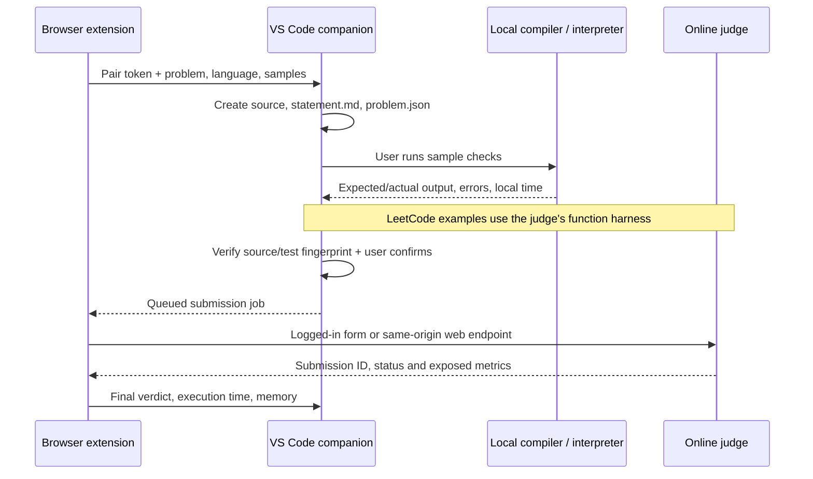

# Mini project notes

## Suggested title

**CP Lab: A browser and VS Code bridge for competitive programming**

## Problem and objective

Competitive programmers repeatedly copy problem statements, write local files, run examples, copy code back to a website and inspect verdicts. CP Lab connects those steps in a small local workflow and blocks submission until the saved source has passed the available sample checks.

## Architecture

The browser cannot freely create local files or launch a compiler. A companion extension uses VS Code's Node environment to do that. The browser uses the `vscode://` application URI to start VS Code when needed. There is no separately installed server app.

## Modules

- **Browser popup:** chooses the language, pairs to VS Code and imports the active problem.
- **DOM adapters:** parse Codeforces and AtCoder samples; query LeetCode's question data and language snippet.
- **Local HTTP bridge:** accepts imports and serves a single active job at a time on `127.0.0.1:27182`.
- **Runner:** spawns a compiler/interpreter without a shell, compiles in a temporary folder and runs each case with a timeout and output bound.
- **Pre-submit checks:** validate nonempty source, compilation/syntax, sample output, and exact code/test fingerprint. Starter TODOs are blocked for local templates. No-test cases stay blocked. A confirmation names the problem, language, and judge.
- **Judge adapters:** Codeforces/AtCoder submit through the native form, keeping site CSRF handling; LeetCode uses its web run/submit endpoints with the browser CSRF token.
- **Result view:** renders local test details and platform verdict/time/memory. Escapes all problem text and judge output before rendering.

## Important design choices

1. **Two local extensions:** a standard browser extension cannot directly run local compilers by itself.
2. **Pairing:** a random token is required for every bridge request. The server binds only to loopback, checks the Host header and rejects web origins outside Chrome extension origins. Extension-local token storage is restricted to extension contexts.
3. **No credentials in the bridge:** browser cookies stay in the browser. LeetCode's CSRF cookie is used only in a same-origin browser request.
4. **No silent resubmission:** jobs are claimed once. Native-submit state is saved before navigating/posting. An uncertain response is surfaced so the user can check the judge first.
5. **New result correlation:** native judges record a baseline submission ID before posting, then track a new ID for the same problem. The user must not submit concurrently by another method. LeetCode returns an exact submission/run ID.
6. **Honest metrics:** local timing is wall time and is labelled local. Online metrics come from the judge. No metric is fabricated when missing.
7. **LeetCode harness:** snippets define a Solution class/function rather than a complete stdin/stdout program. Its Run Code API handles the signature, data structures and expected output.
8. **No hidden-test claims:** passing samples only establishes those particular checks passed.

## Execution and security scope

This is a local tool for code you write. Running checks executes that source with your normal user permissions; it is not an OS sandbox. Timeouts/output limits are guardrails for accidental infinite loops and excessive output, not isolation for hostile programs. Java runs with a 256 MB heap; C++/Python do not have an OS-enforced memory quota. Do not use it to run untrusted solutions.

## Limits and future work

- Three explicit adapters; other sites require implementation and verification.
- Judge pages and undocumented web endpoints can change, require verification or refuse automation.
- No authentication or CAPTCHA bypass. Contest policies still apply.
- No offline LeetCode execution, special checkers, interactive tasks or custom judge.
- Metrics may be absent, especially while judging or after a compilation error.
- One active browser job, one VS Code bridge window, one fixed port; jobs/results are session-only.
- Source and custom tests persist on disk; results/check fingerprints reset when VS Code reloads.
- Useful future additions: more adapters, configurable custom checkers, richer problem rendering, persistent result history, a real VS Code Extension Host automation suite, and macOS CI with signed packages.

## Suggested college demo

1. Explain the two components and pair them.
2. Import a Codeforces problem and show the generated statement/source/tests.
3. Write a wrong solution; show expected and actual output.
4. Show submission blocked after a failed run.
5. Correct the solution and pass samples.
6. Change the source and show the previous check is invalidated.
7. Re-run, confirm submission and show the verdict/metrics from a practice problem.
8. Import LeetCode Two Sum to show the different function harness.

Do not present fixture screenshots as live acceptance evidence. Use your own practice account for a live demonstration.
